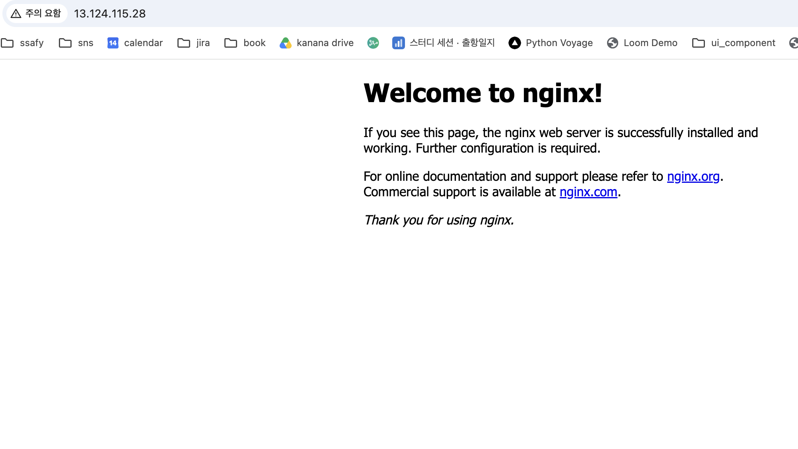

# 내가 만든 웹사이트를 인터넷에 올려 누구나 쓰게 하기

AWS 서울 리전(ap-northeast-2)에 VPC를 직접 설계하고 EC2에 웹 서버를 배포한 기록입니다.

## 외부 접속 검증

- **선택한 방식: (A) 브라우저에서 `http://<퍼블릭IP>` 접속**
- 접속 정보: `http://13.124.115.28` (자동 할당 퍼블릭 IP — 인스턴스 중지/시작 또는 종료 시 변경·반납됨)
- 결과: Nginx 기본 페이지 "Welcome to nginx!" 정상 표시

## 진행 체크리스트

### 0. 계정/권한 (IAM)
- [x] 최소권한 IAM 정책 작성 (EC2/VPC/SG 범위, 서울 리전 제한)
- [x] 실습용 IAM 사용자 생성 + 정책 연결 (AdministratorAccess 미사용)
- [x] IAM 사용자로 콘솔 로그인, 루트 계정 사용 중단
- [x] S3 접근 거부 스크린샷 (최소권한 증빙) → `docs/img/iam-s3-denied.png`

### 1. 네트워크
- [x] VPC 1개 생성 (`b3-1-vpc`, 10.0.0.0/16)
- [x] Public Subnet 1개 생성 (`b3-1-public-subnet`, 10.0.1.0/24, ap-northeast-2a, 퍼블릭 IP 자동 할당)
- [x] Internet Gateway 생성 및 VPC 연결 (`b3-1-igw`, Attached)
- [x] Route Table에 `0.0.0.0/0 → IGW` 경로 추가 및 서브넷 연결 (`b3-1-public-rt`)

### 2. 보안 그룹
- [x] HTTP(80) ← 0.0.0.0/0 (`b3-1-web-sg`)
- [x] SSH(22) ← 내 IP/32 만
- [x] 전체 포트 0.0.0.0/0 허용 규칙 없음 확인 (인바운드 2개뿐)

### 3. 컴퓨트 / 웹 서버
- [x] 키페어 생성 및 안전 보관 (`b3-1-key`, 레포 밖 ~/.ssh)
- [x] EC2 (t2/t3.micro, 8~10GiB) 생성 (`b3-1-web`, t3.micro, Ubuntu 26.04 LTS)
- [x] SSH 접속 성공
- [x] 인스턴스에서 `curl https://example.com` 성공 (아웃바운드, HTTP/2 200)
- [x] Nginx 설치 및 실행 (nginx/1.28.3, :80 LISTEN, enable 등록)
- [x] 인스턴스에서 `curl http://localhost` → 200

### 4. 외부 접속 검증
- [x] 검증 방식 선택 (A/B) 및 README 기재 → (A) 브라우저
- [x] 외부 접속 스크린샷

### 5. 문서
- [x] `docs/architecture.png` (직접 작성, Excalidraw) — 참고용: `docs/architecture-reference.png`
- [x] `docs/troubleshooting.md` (증상→가설→검증→조치→결과→재발방지) — 사례 1: 리전 불일치
- [x] `docs/cleanup-checklist.md`

### 6. 정리
- [x] EC2 종료 / EBS 삭제 / EIP 해제 / IGW 분리·삭제 / VPC 삭제
- [ ] (선택) Billing 화면 스크린샷 — 생략

### 보너스 (선택)
- [ ] HTTPS (Let's Encrypt)
- [ ] Docker 컨테이너 배포
