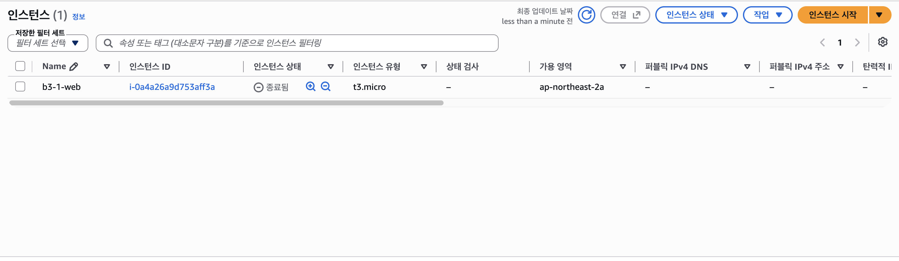
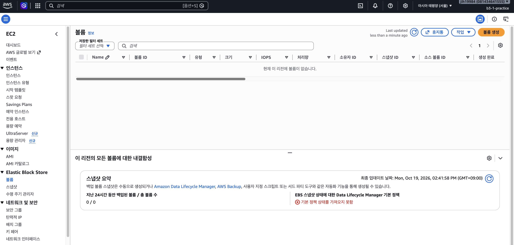
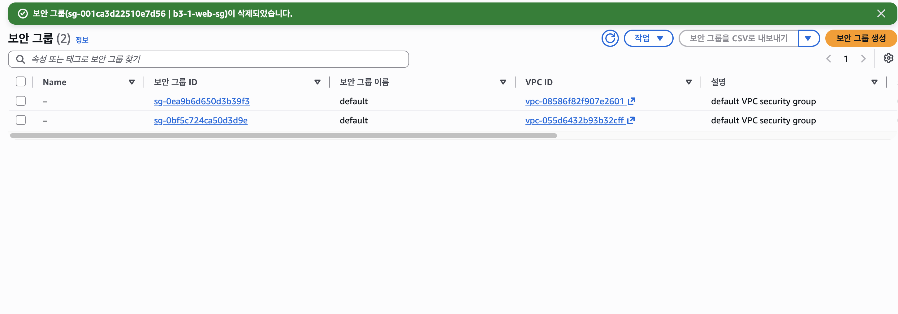
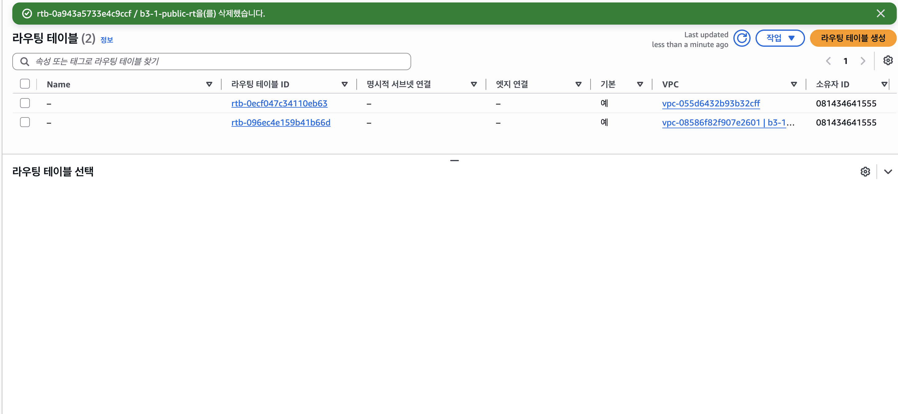
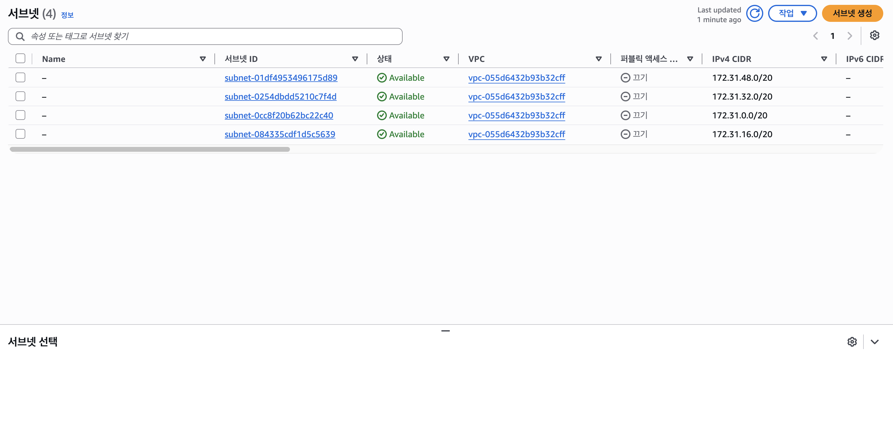
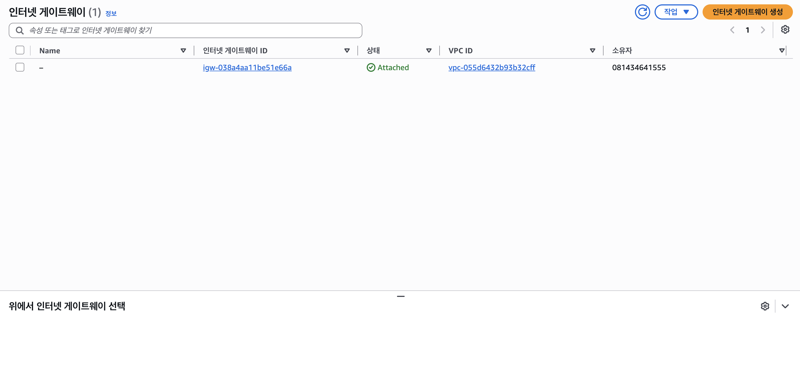
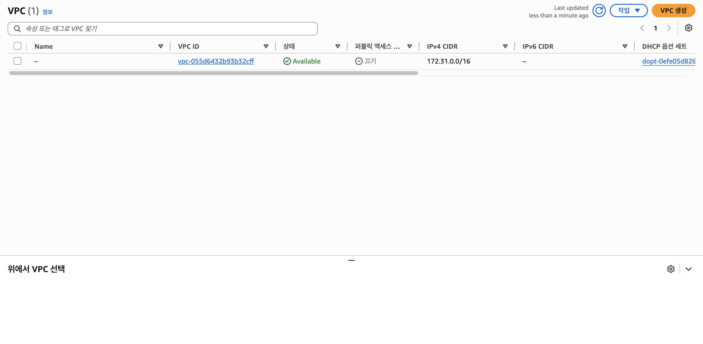
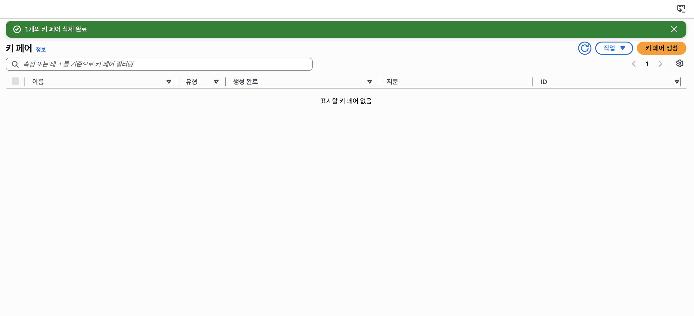

# 리소스 정리 체크리스트

- 리전: 서울 `ap-northeast-2`
- 정리 수행 계정: IAM 사용자 `b3-1-practice`
- 정리 일시: 2026-10-19
- 원칙: **생성의 역순**으로 삭제한다. 다른 리소스가 참조 중인 리소스는 삭제되지 않으므로, 사용하는 쪽(EC2)부터 지우고 기반(VPC)을 마지막에 지운다.

## 정리 순서와 결과

| # | 리소스 | 이름 / ID | 과금 위험 | 조치 | 상태 | 근거 |
|---|---|---|---|---|---|---|
| 1 | EC2 인스턴스 | `b3-1-web` / `i-0a4a26a9d753aff3a` | 높음 (실행 시간) | 종료(Terminate) | ✅ 종료됨 |  |
| 2 | EBS 볼륨 | 루트 볼륨 8GiB gp3 | 높음 (남으면 계속 과금) | 인스턴스 종료 시 함께 삭제 → 목록 확인 | ✅ 볼륨 0개 |  |
| 3 | 퍼블릭 IPv4 / Elastic IP | `13.124.115.28` (자동 할당) / EIP 없음 | 높음 (EIP 미반납 시) | 인스턴스 종료로 자동 반납, EIP 미생성 | ✅ 퍼블릭 IPv4 `–` (반납됨) | c1 스크린샷의 퍼블릭 IPv4 주소 열 |
| 4 | 보안 그룹 | `b3-1-web-sg` / `sg-001ca3d22510e7d56` | 없음 | 삭제 | ✅ 삭제됨 (남은 것은 VPC별 `default` SG뿐) |  |
| 5 | 라우팅 테이블 | `b3-1-public-rt` / `rtb-0a943a5733e4c9ccf` | 없음 | 서브넷 연결 해제 후 삭제 | ✅ 삭제됨 (남은 b3-1-vpc 기본 RT는 VPC 삭제 시 함께 제거) |  |
| 6 | 서브넷 | `b3-1-public-subnet` / `subnet-08efe13b79dfcba22` | 없음 | 삭제 | ✅ 삭제됨 (기본 VPC 서브넷 4개만 남음) |  |
| 7 | 인터넷 게이트웨이 | `b3-1-igw` / `igw-0e3a093daa8626fee` | 없음 | VPC에서 분리(Detach) 후 삭제 | ✅ 삭제됨 (기본 VPC의 IGW만 남음) |  |
| 8 | VPC | `b3-1-vpc` / `vpc-08586f82f907e2601` | 없음 | 삭제 | ✅ 삭제됨 (기본 VPC `172.31.0.0/16`만 남음) |  |
| 9 | 키 페어 | `b3-1-key` | 없음 | AWS에서 삭제 + 로컬 `~/.ssh/b3-1-key.pem` 삭제 | ✅ AWS 키 페어 0개 + 로컬 파일 삭제 (`ls`: No such file or directory) |  |

## 생성하지 않은 리소스 (해당 없음 확인)

| 리소스 | 상태 |
|---|---|
| NAT Gateway | 생성하지 않음 |
| ELB / ALB | 생성하지 않음 |
| RDS | 생성하지 않음 |
| Elastic IP | 생성하지 않음 |

## 남겨 둔 것 (의도적)

| 리소스 | 이유 |
|---|---|
| 기본 VPC `vpc-055d6432b93b32cff` 및 그 서브넷·IGW·default SG | AWS가 계정 생성 시 만든 기본 리소스. 무료이며 삭제 시 복구가 번거로움 |
| IAM 사용자 `b3-1-practice` / 정책 | 무료. 과제 증빙 확인용으로 유지 (필요 시 이후 삭제) |

## 최종 확인

- [ ] (권장) Billing Dashboard에서 과금 항목이 남지 않았는지 확인 — 생략 (선택 항목). 과금 위험 리소스(EC2·EBS·퍼블릭 IP)는 위 1~3번 스크린샷으로 삭제를 확인함
