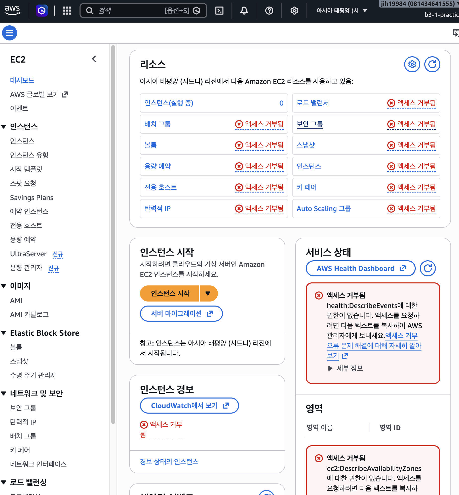
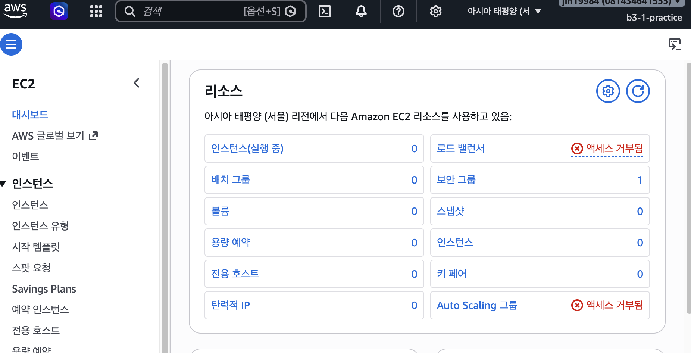

# 트러블슈팅 보고서

## 사례 1. IAM 사용자로 로그인 후 EC2 콘솔 대부분이 "액세스 거부됨"

| 항목 | 내용 |
|---|---|
| 증상 | IAM 사용자(`b3-1-practice`)로 로그인해 EC2 대시보드를 열자 보안 그룹·키 페어·볼륨 등 대부분 항목이 "액세스 거부됨"으로 표시됨. 서비스 상태 영역에는 `ec2:DescribeAvailabilityZones`, `health:DescribeEvents` 권한 없음 메시지 표시 |
| 원인 가설 | ① 정책 JSON 자체가 잘못 작성됨 ② 정책은 정상이나 접속한 리전이 정책 조건과 다름 |
| 검증 방법 | 대시보드 문구에서 현재 리전이 **아시아 태평양(시드니) `ap-southeast-2`** 임을 확인. 연결된 정책의 Condition은 `aws:RequestedRegion = ap-northeast-2`(서울)만 허용 → 가설 ② 채택. 리전 설정은 사용자별로 저장되므로 루트에서 바꾼 리전이 IAM 사용자에게는 적용되지 않았음 |
| 조치 내용 | 콘솔 우측 상단 리전 선택기에서 **아시아 태평양(서울) `ap-northeast-2`** 로 변경 |
| 결과 | 서울 리전에서 EC2 대시보드 정상 조회(보안 그룹 1 = 기본 VPC의 default SG, 나머지 0). 로드 밸런서·Auto Scaling 그룹은 여전히 거부되는데, 각각 `elasticloadbalancing:`, `autoscaling:` 네임스페이스로 `ec2:*`에 포함되지 않기 때문 → 실습에 불필요하므로 의도된 거부 |
| 재발 방지 | 작업 시작 전 체크리스트에 "IAM 사용자 로그인 후 우측 상단 리전이 서울(`ap-northeast-2`)인지 확인" 항목 추가. "액세스 거부"가 보이면 정책을 고치기 전에 리전부터 확인 |

참고: `health:DescribeEvents` 거부는 리전과 무관하게 AWS Health 서비스 권한이 정책에 없어서 발생. 실습에 불필요하므로 의도된 거부(최소권한)로 판단.

